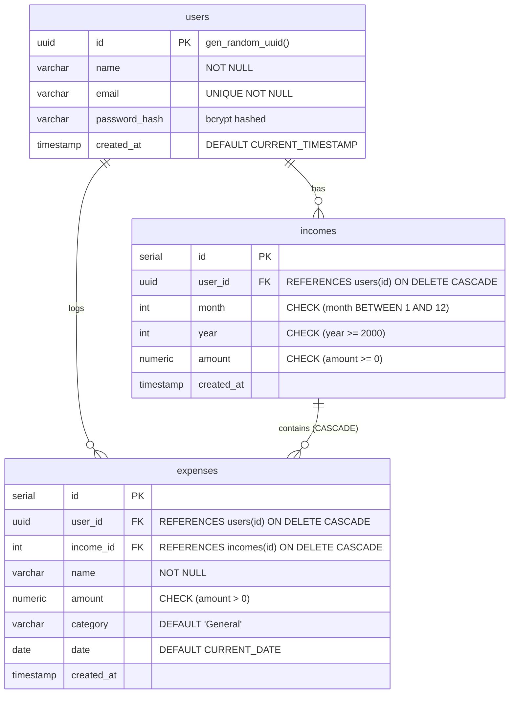

# Monthly Budget Tracker - Full Stack Mobile Application (iOS / Expo + Node.js + Neon PostgreSQL)

An iOS-first mobile application built with **React Native (Expo)**, **Node.js (Express)**, and **Neon Serverless PostgreSQL**. The application enables users to track monthly income, record categorized expenses, and dynamically monitors their remaining balance in real time with taste-skill inspired design craft.

---

## 📸 Key Features & Rubric Alignment (100 + 10 Marks)

| Requirement | Description | Status |
|---|---|---|
| **F1: Register / Login** | JWT Authentication with bcrypt (10 rounds) password hashing | ✅ Complete |
| **F2: Set Monthly Income** | Set or update monthly income (e.g. Rs. 100,000) with UPSERT semantics | ✅ Complete |
| **F3: Add Expense** | Enter Name, Amount, Category, Date (e.g. Electricity Bill - 8,000) | ✅ Complete |
| **F4: Auto Deduction** | Balance dynamically recalculated: `Income - SUM(Expenses)` (100,000 - 8,000 = 92,000) | ✅ Complete |
| **F5: Expense Table / List** | Categorized list with name, amount, date, search, and category filter | ✅ Complete |
| **F6: Edit Expense** | Modifying name or amount automatically updates the balance on the fly | ✅ Complete |
| **F7: Delete Expense** | Deleting expense automatically restores the amount back to balance | ✅ Complete |
| **F8: Summary Cards** | Total Income, Total Expense, and Remaining Balance cards with status indicator | ✅ Complete |
| **F9: Month Selector** | Seamless navigation across months and years with "Jump to Today" shortcut | ✅ Complete |
| **F10: Logout** | Securely invalidates session, clears token, and returns to Login | ✅ Complete |
| **Bonus 1: Expense Categories** | 8 categories (Food, Bills, Travel, Shopping, Health, Entertainment, Education, General) with distinct color badges and visual segmented breakdown bar | 🌟 Complete |
| **Bonus 2: 80% Budget Alert** | Automatic warning banner when ≥ 80% of monthly income is consumed | 🌟 Complete |
| **Bonus 3: Month Comparison** | Real-time percentage comparison and trend vs previous month | 🌟 Complete |
| **Bonus 4: Export to CSV** | Generates formatted CSV statement ready to copy or download | 🌟 Complete |
| **Bonus 5: Dark & Light Mode** | Obsidian Dark & Ceramic Slate themes crafted with `Leonxlnx/taste-skill` standards | 🌟 Complete |

---

## ⚖️ Balance Warning & Business Logic Policy

### 1. Dynamic On-the-Fly Balance Calculation
> **Important Rule Compliance:** The remaining balance is **never stored in the database**. It is calculated on every request as:
> $$\text{Remaining Balance} = \text{Total Income} - \sum \text{Expenses}$$
> This prevents data drift, stale cache, or discrepancies during concurrent edits and deletions.

### 2. Trainee Decision: Over-Budget Expense Handling
When an expense amount exceeds the current remaining balance:
- **Decision:** **Allowed with Warning.**
- **Rationale:** In real-world personal finance, unexpected emergencies (e.g., medical bills or car repairs) can temporarily drive cash flow into deficit. Blocking the user from recording the expense leads to unrecorded spending and inaccurate tracking. Instead, the application allows the expense, logs the deficit, and triggers:
  1. A live amber warning during form entry (`amount > remaining balance`).
  2. A persistent red **Deficit Alert Card** showing the exact negative balance.
  3. A progress bar turning crimson to signal an over-budget status.

---

## 🗄️ Database Architecture (Neon PostgreSQL)



---

## 📡 API Endpoints

All endpoints except `/api/auth/*` require a Bearer JWT Token: `Authorization: Bearer <TOKEN>`.

| Method | Endpoint | Description |
|---|---|---|
| `POST` | `/api/auth/register` | Create user account with name, email, password |
| `POST` | `/api/auth/login` | Authenticate and obtain JWT token |
| `GET` | `/api/auth/profile` | Fetch authenticated user details |
| `POST` | `/api/income` | Set or update monthly income (UPSERT by month/year) |
| `GET` | `/api/income?month=&year=` | Get income, total expenses, and dynamic remaining balance |
| `POST` | `/api/expenses` | Add new expense (validates name and positive amount) |
| `GET` | `/api/expenses?month=&year=&category=` | List itemized expenses with category breakdown |
| `PUT` | `/api/expenses/:id` | Edit expense name, amount, category, or date |
| `DELETE` | `/api/expenses/:id` | Delete expense and restore amount to balance |
| `GET` | `/api/health` | Service health check |

---

## 🚀 Quick Setup & Execution Guide

### 1. Backend Setup
```bash
cd backend
npm install
```

#### Environment Variables (`backend/.env`)
```env
PORT=5000
NODE_ENV=development
DATABASE_URL=postgresql://<user>:<password>@<neon-host>/neondb?sslmode=require
JWT_SECRET=monthly_budget_tracker_jwt_secret_key_2026_trainee
JWT_EXPIRES_IN=7d
```
*(Note: If `DATABASE_URL` is omitted, the backend automatically runs on a high-performance in-memory PostgreSQL engine for zero-config offline testing!)*

#### Database Migration & Demo Seeding
```bash
# Run schema migration against Neon PostgreSQL
npm run migrate

# Seed sample user, income (Rs. 100,000), and sample expenses
npm run seed

# Run automated test suite (22 tests covering F1 - F8 & validation rules)
npm test

# Start backend server
npm start
```

### 2. Mobile App Setup (Expo / React Native)
```bash
cd mobile
npm install
```

#### Run on iOS / Android / Web
```bash
# Start Expo development server
npx expo start

# For iOS Simulator: Press 'i' in terminal or run:
npx expo start --ios

# For Web Browser preview: Press 'w' in terminal or run:
npx expo start --web

# For Physical iPhone via Expo Go:
# Scan the QR code displayed in terminal using Expo Go app on iOS
```

#### Connecting Physical iPhone to Backend
On a physical device, `localhost` points to the phone itself. 
1. Tap the **Settings icon** (⚙️) on the top header of the mobile app.
2. Enter your computer's local Wi-Fi IP (e.g. `http://192.168.1.15:5000`) or your deployed Railway/Render URL.
3. Tap **Test Connection** to verify ping.
4. Or toggle **Built-in Offline Demo Engine** to test every screen without any backend running!

---

## 🧪 Automated Test Verification

The backend includes a comprehensive test suite written with native Node.js test runner:
```
✔ Health check endpoint
✔ F1 - Register and Login (Authentication & JWT)
  ✔ Registers a new user successfully
  ✔ Rejects registration with duplicate email
  ✔ Rejects invalid registration inputs
  ✔ Logs in user with valid credentials
  ✔ Rejects login with incorrect password
✔ F2 & F8 - Monthly Income & Balance Calculations
  ✔ Sets monthly income (Rs. 100,000 for month 11/2026)
  ✔ Duplicate income updates instead of creating duplicate
  ✔ GET /api/income returns summary cards info
✔ F3, F4, F5, F6, F7 - Expense CRUD and Auto Deduction
  ✔ F3 & F4 - Add Expense and Auto Deduction (100,000 - 8,000 = 92,000)
  ✔ F5 - Lists expenses for the month
  ✔ F6 - Edit Expense recalculates balance correctly (8,000 -> 10,000 => balance 90,000)
  ✔ F7 - Delete Expense restores amount back to balance (balance back to 100,000)
✔ Validation Rules & Warnings
  ✔ Rejects expense with negative amount
  ✔ Rejects expense with zero amount
  ✔ Rejects expense with empty name
  ✔ Generates balance warning when expense exceeds remaining balance
  ✔ Protected endpoints reject unauthenticated requests

ℹ tests 22 | pass 22 | fail 0
```
